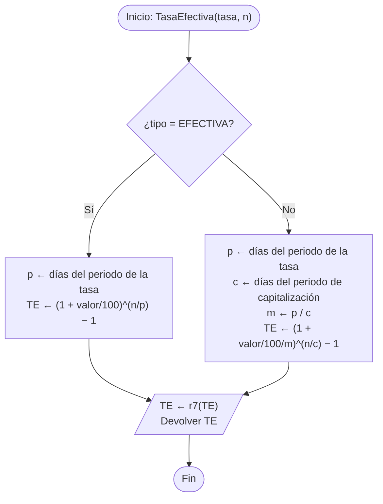
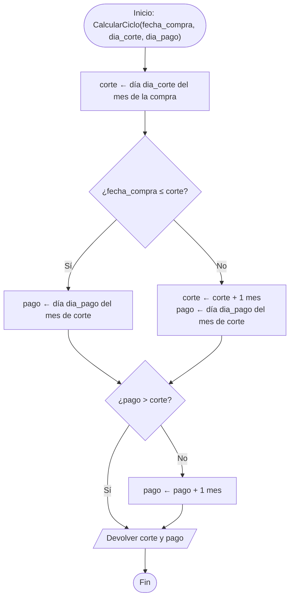
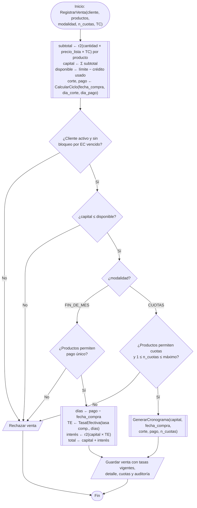
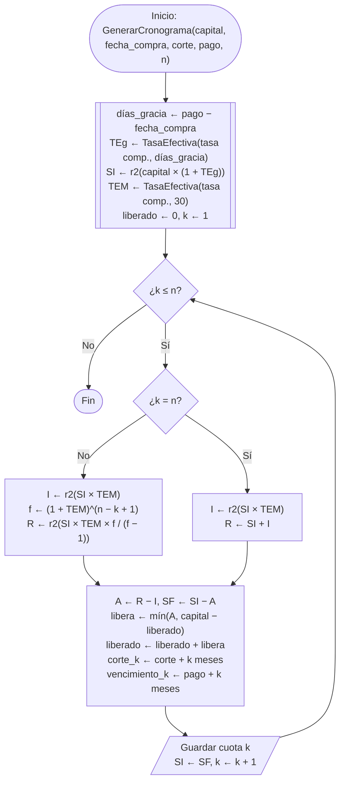
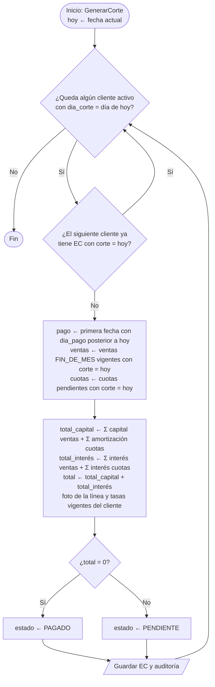
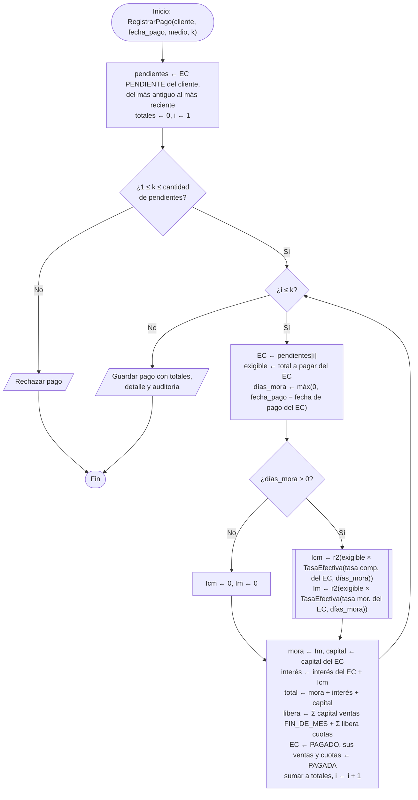

# 7. Algoritmo

El algoritmo de solución se presenta mediante diagramas de flujo. Cada diagrama describe un
proceso con sus variables, decisiones y ciclos, siguiendo las reglas de
[especificacion-financiera.md](../especificacion-financiera.md).

## 7.1 Notación

| Símbolo | Significado |
|---|---|
| Óvalo | Inicio o fin |
| Paralelogramo | Entrada o salida de datos |
| Rectángulo | Proceso o asignación (`←`) |
| Rombo | Decisión |
| Rectángulo con doble borde | Llamada a otro algoritmo |

- `r2(x)`: redondeo a 2 decimales, half-up (montos de dinero).
- `r7(x)`: redondeo a 7 decimales en porcentaje (tasas).
- Días: diferencia en días calendario exactos entre dos fechas. Año de 360 días.

## 7.2 Conversión de tasas: `TasaEfectiva(tasa, n)`

Convierte cualquier tasa pactada, nominal o efectiva, en la tasa efectiva para `n` días, en
un solo paso.

## 7.3 Ciclo de la compra: `CalcularCiclo`

Determina en qué fecha de corte cae una compra y cuál es su fecha de pago.

## 7.4 Registro de una venta: `RegistrarVenta`

## 7.5 Cronograma de cuotas: `GenerarCronograma`

Método francés vencido ordinario, con periodo de gracia total capitalizado y cuota calculada
cada periodo sobre el saldo inicial (Fórmula 67 del libro del profesor).

## 7.6 Generación del estado de cuenta: `GenerarCorte`

Se ejecuta automáticamente todos los días al cierre (23:59:59).

## 7.7 Registro de un pago: `RegistrarPago`

Los estados de cuenta se pagan completos y en orden, del más antiguo al más reciente. Los
intereses por mora se calculan con los días reales de atraso y se desglosan según el orden
de imputación del Anexo A.

