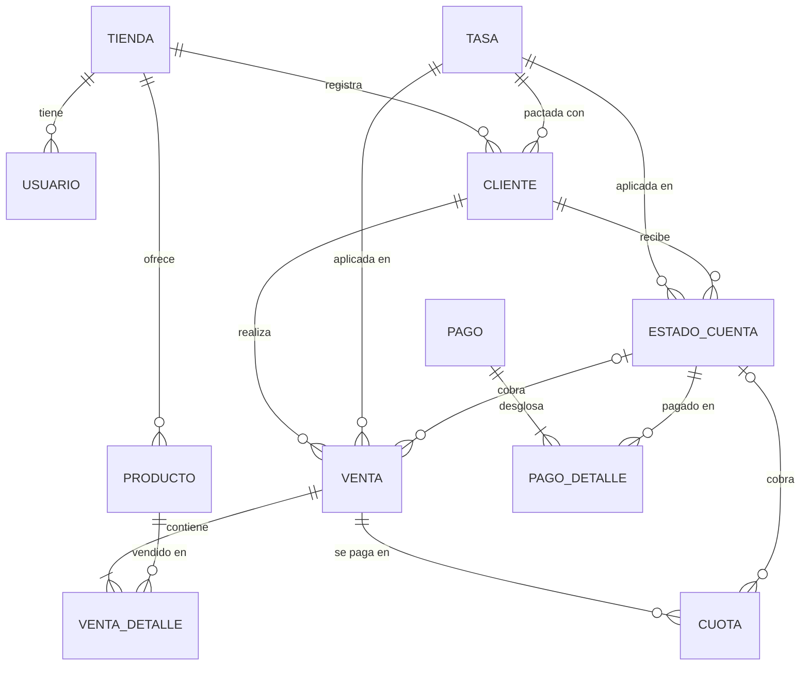

# 8. Modelo de la base de datos

## 8.1 Motor y convenciones

La base de datos se implementa en **PostgreSQL**. Se eligió porque su tipo `NUMERIC` guarda
valores decimales exactos, sin los errores de redondeo de los tipos de punto flotante. Esto
es indispensable para cumplir las convenciones del Anexo A: montos con 2 decimales y tasas
con al menos 7.

| Dato | Tipo |
|---|---|
| Montos de dinero | `NUMERIC(12,2)` |
| Tasas de interés (como fracción) | `NUMERIC(12,9)`: 7 decimales en porcentaje |
| Tipo de cambio | `NUMERIC(8,3)` |
| Fechas de corte, pago y vencimiento | `DATE` |
| Fecha y hora de registro | `TIMESTAMPTZ` |

Las tablas se nombran en singular, en español y en `snake_case`. Cada tabla usa una llave
primaria numérica autoincremental (`id`).

## 8.2 Modelo conceptual

La Figura 8.1 muestra las entidades del sistema y cómo se relacionan, sin atributos.

*Figura 8.1. Modelo conceptual.*

## 8.3 Modelo lógico

La Figura 8.2 presenta el modelo completo, con 14 tablas, sus atributos, tipos de dato y
llaves.

*[Insertar aquí la Figura 8.2: diagrama exportado de dbdiagram.io a partir de
`docs/modelo-datos.dbml`.]*

*Figura 8.2. Modelo lógico de la base de datos.*

El diccionario de datos completo y el script de creación de la base de datos se incluyen en
los anexos.

## 8.4 Descripción de las relaciones

| Relación | Cardinalidad | Descripción |
|---|---|---|
| tienda – usuario | 1 : N | Una tienda tiene su usuario vendedor. El administrador del sistema no pertenece a ninguna tienda. |
| tienda – configuración | 1 : 1 | Valores por defecto que la tienda usa al registrar clientes. |
| tienda – producto / cliente | 1 : N | Cada tienda tiene su propio catálogo y sus propios clientes. |
| tasa – cliente / venta / estado_cuenta | 1 : N | Cada cliente tiene una tasa compensatoria y una moratoria. Cada venta conserva las tasas vigentes al registrarse, y cada estado de cuenta las vigentes al corte, con las que se calcula la mora. |
| cliente – venta | 1 : N | Un cliente realiza muchas ventas a crédito; cada venta pertenece a un solo cliente. |
| venta – venta_detalle | 1 : N | Una venta incluye uno o más productos. |
| venta – cuota | 1 : N | Una venta en cuotas genera su cronograma. Una venta a fin de mes no tiene cuotas. |
| cliente – estado_cuenta | 1 : N | Se genera un estado de cuenta por cliente en cada fecha de corte. |
| estado_cuenta – venta / cuota | 1 : N | El estado de cuenta cobra las ventas a fin de mes y las cuotas que vencen en su fecha de pago. Se vinculan por el cliente y la fecha de corte, que identifican un único estado de cuenta. |
| pago – pago_detalle | 1 : N | Un pago puede cancelar uno o varios estados de cuenta, siempre del más antiguo al más reciente. El cliente del pago se obtiene de los estados de cuenta que cancela. |
| estado_cuenta – pago_detalle | 1 : N | Guarda el desglose del pago de cada estado de cuenta: mora, interés y capital. |

## 8.5 Decisiones de diseño

1. **Tasas inmutables.** Cada tasa pactada se registra una sola vez y no se modifica. Si
   cambian las condiciones de un cliente, se crea una tasa nueva. Así cada venta conserva las
   condiciones con que se realizó.
2. **Montos calculados al registrar.** Al registrar una venta se calculan y guardan su
   interés, sus fechas de corte y de pago y, si es en cuotas, su cronograma completo. El corte
   solo agrupa lo ya calculado. Esto permite auditar cada cifra.
3. **Datos derivados.** El crédito usado y el estado "vencido" no se almacenan; se calculan a
   partir de las ventas y los pagos. Así se evita que queden desactualizados.
4. **Separación entre tiendas.** Las tablas que pertenecen directamente a una tienda
   (usuario, producto, cliente y configuración) incluyen `tienda_id`. Las demás llegan a la
   tienda a través del cliente. Cada consulta del vendedor filtra por su tienda, y el
   administrador del sistema no accede a esta información.
5. **Desnormalizaciones deliberadas:**
   - `venta_detalle` copia la descripción y el precio del producto, para que la venta no
     cambie si luego se edita el catálogo.
   - `estado_cuenta` guarda una foto de la línea de crédito al momento del corte, porque el
     documento es inmutable.
6. **Trazabilidad.** Los pagos no se eliminan, se anulan indicando el motivo. Las ventas solo
   pueden anularse antes de ser incluidas en un estado de cuenta. Todas las operaciones se
   registran en la tabla `auditoria`.

**Normalización.** Todas las tablas cumplen la tercera forma normal (3FN), con una excepción
deliberada: los resultados de los cálculos financieros (interés, total, tasa del periodo,
cronograma de cuotas, totales del estado de cuenta y TEA equivalente) se almacenan aunque
puedan derivarse de otros atributos. Se guardan porque son las cifras que se le informaron al
cliente: así cada monto es auditable y un documento emitido no cambia aunque luego se
modifique el sistema. Es una práctica habitual en sistemas financieros y contables.

## 8.6 Reglas de integridad

| Restricción | Regla de negocio que protege |
|---|---|
| `dia_corte` y `dia_pago` entre 1 y 28 | Todo mes tiene esos días. |
| `precio_lista ≥ precio_contado` | El precio a crédito no puede ser menor que el precio al contado. |
| Tasa nominal con capitalización obligatoria; tasa efectiva sin capitalización | La conversión entre tasa nominal y efectiva requiere el periodo de capitalización. |
| Venta a fin de mes sin cuotas; venta en cuotas con `numero_cuotas ≥ 1` | Cada modalidad tiene su propio esquema de pago. |
| `total = total_mora + total_interes + total_capital` en `pago` | El desglose del pago es completo, según el orden de imputación del Anexo A. |
| Un estado de cuenta por cliente y fecha de corte | No se puede generar dos veces el mismo corte. |
| Estado de cuenta con total 0 solo puede estar `PAGADO` | Un estado de cuenta sin deuda nunca figura como vencido ni bloquea ventas. |
| Documento del cliente único por tienda | Una tienda no registra dos veces al mismo cliente. |
| Usuario `VENDEDOR` con tienda; `ADMIN` sin tienda | El administrador no pertenece a ninguna tienda. |
