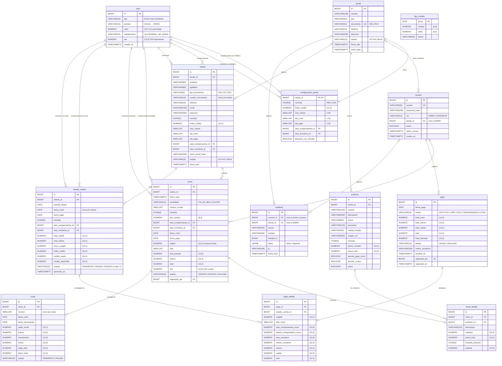

# FiaMe — Modelo de datos

Sección 8 del informe. Base de datos PostgreSQL. Nombres en español, `snake_case`,
tablas en singular.

## Convenciones

| Dato | Tipo | Motivo |
|---|---|---|
| Dinero | `NUMERIC(12,2)` | 2 decimales exactos (R3). Nunca `float`. |
| Tasa como fracción | `NUMERIC(12,9)` | 7 decimales en porcentaje = 9 como fracción (R4). |
| Tasa ingresada por el usuario (en %) | `NUMERIC(12,7)` | Se guarda tal como la escribió. |
| Tipo de cambio | `NUMERIC(8,3)` | 3 decimales, como la SBS. |
| Cantidad | `NUMERIC(10,3)` | Permite kg, litros, etc. |
| Fechas de negocio | `DATE` | Corte, pago, vencimiento: el cálculo es por días. |
| Momentos del sistema | `TIMESTAMPTZ` | Registro, auditoría. Zona horaria America/Lima. |
| Identificadores | `BIGINT` autoincremental | |

Las tablas que pertenecen directamente a una tienda (`configuracion_tienda`, `usuario`,
`producto`, `cliente`) llevan `tienda_id`. Las demás llegan a la tienda a través del cliente,
sin repetir la columna. Todas las consultas del vendedor filtran por su tienda, así una tienda
nunca ve datos de otra.

## Diagrama entidad-relación

## Tablas

### `tasa`
Una tasa tal como fue pactada. **Inmutable**: nunca se edita. Si cambian las condiciones de
un cliente, se crea una fila nueva. Por eso una venta que apunta a una tasa conserva las
condiciones con que se hizo, sin tener que copiarlas.

| Campo | Tipo | Restricciones |
|---|---|---|
| id | BIGINT | PK |
| tipo | VARCHAR(10) | `EFECTIVA` \| `NOMINAL` |
| periodo | VARCHAR(15) | `ANUAL`, `SEMESTRAL`, `CUATRIMESTRAL`, `TRIMESTRAL`, `BIMESTRAL`, `MENSUAL`, `QUINCENAL`, `DIARIA` |
| valor | NUMERIC(12,7) | > 0, en porcentaje |
| capitalizacion | VARCHAR(15) | Obligatoria si `NOMINAL` (por defecto `DIARIA`, R19); nula si `EFECTIVA`. Periodo ≤ periodo de la tasa |
| tea | NUMERIC(12,9) | TEA equivalente, calculada al crear (R14) |
| creado_en | TIMESTAMPTZ | |

### `tienda`
| Campo | Tipo | Restricciones |
|---|---|---|
| id | BIGINT | PK |
| nombre | VARCHAR(120) | Obligatorio |
| giro | VARCHAR(40) | Bodega, frutería, carnicería, peluquería, spa, otro… |
| documento | VARCHAR(11) | DNI (8) o RUC (11), opcional, único |
| telefono | VARCHAR(15) | |
| direccion | VARCHAR(200) | |
| estado | VARCHAR(10) | `ACTIVA` \| `BAJA` |
| fecha_alta | TIMESTAMPTZ | |
| fecha_baja | TIMESTAMPTZ | Nula si activa |

### `configuracion_tienda`
Valores por defecto al registrar clientes (1 a 1 con `tienda`).

| Campo | Tipo | Restricciones |
|---|---|---|
| tienda_id | BIGINT | PK, FK → tienda |
| moneda | CHAR(3) | `PEN` \| `USD` |
| limite_credito | NUMERIC(12,2) | > 0 |
| max_meses | SMALLINT | 1–36 |
| dia_corte | SMALLINT | 1–28 |
| dia_pago | SMALLINT | 1–28 |
| tasa_compensatoria_id | BIGINT | FK → tasa |
| tasa_moratoria_id | BIGINT | FK → tasa |
| bloquear_con_vencido | BOOLEAN | Por defecto `true` |

### `usuario`
| Campo | Tipo | Restricciones |
|---|---|---|
| id | BIGINT | PK |
| usuario | VARCHAR(60) | Único |
| password_hash | VARCHAR(255) | bcrypt/argon2, nunca la clave en texto |
| rol | VARCHAR(10) | `ADMIN` \| `VENDEDOR` |
| tienda_id | BIGINT | FK → tienda. Nula si `ADMIN`, obligatoria si `VENDEDOR` |
| activo | BOOLEAN | |
| ultimo_acceso | TIMESTAMPTZ | |
| creado_en | TIMESTAMPTZ | |

### `producto`
| Campo | Tipo | Restricciones |
|---|---|---|
| id | BIGINT | PK |
| tienda_id | BIGINT | FK → tienda |
| nombre | VARCHAR(120) | Obligatorio |
| descripcion | VARCHAR(500) | |
| marca | VARCHAR(60) | |
| proveedor | VARCHAR(120) | Opcional |
| unidad_medida | VARCHAR(20) | Unidad, kg, litro, servicio… |
| imagen_url | VARCHAR(500) | |
| moneda | CHAR(3) | `PEN` \| `USD` |
| precio_contado | NUMERIC(12,2) | > 0 |
| precio_lista | NUMERIC(12,2) | ≥ precio_contado |
| permite_pago_unico | BOOLEAN | Fin de mes |
| permite_cuotas | BOOLEAN | Al menos una de las dos modalidades en `true` |
| activo | BOOLEAN | Baja lógica |

### `cliente`
| Campo | Tipo | Restricciones |
|---|---|---|
| id | BIGINT | PK |
| tienda_id | BIGINT | FK → tienda |
| nombres | VARCHAR(80) | |
| apellidos | VARCHAR(80) | |
| tipo_documento | VARCHAR(5) | `DNI` \| `CE` \| `RUC` |
| numero_documento | VARCHAR(12) | Único por tienda |
| telefono | VARCHAR(15) | Para compartir el enlace por WhatsApp |
| email | VARCHAR(120) | |
| direccion | VARCHAR(200) | |
| moneda | CHAR(3) | `PEN` \| `USD` |
| limite_credito | NUMERIC(12,2) | > 0 |
| max_meses | SMALLINT | 1–36 |
| dia_corte | SMALLINT | 1–28 |
| dia_pago | SMALLINT | 1–28 |
| tasa_compensatoria_id | BIGINT | FK → tasa |
| tasa_moratoria_id | BIGINT | FK → tasa |
| token_portal_hash | VARCHAR(255) | Hash del token del enlace; regenerar invalida el anterior |
| estado | VARCHAR(10) | `ACTIVO` \| `BAJA` |
| fecha_alta | TIMESTAMPTZ | |

Regla: `dia_corte`, `dia_pago` y `moneda` no se pueden cambiar si el cliente tiene ventas o
cuotas sin pagar, porque las fechas y montos ya calculados dependen de ellos.

### `venta`
Cabecera de una venta a crédito. Todos los montos se calculan y fijan al registrarla.

| Campo | Tipo | Restricciones |
|---|---|---|
| id | BIGINT | PK |
| cliente_id | BIGINT | FK → cliente |
| fecha_hora | TIMESTAMPTZ | Define el ciclo (corte a las 23:59:59) |
| modalidad | VARCHAR(12) | `FIN_DE_MES` \| `CUOTAS` |
| numero_cuotas | SMALLINT | Nulo si fin de mes; 1–`cliente.max_meses` si cuotas |
| moneda | CHAR(3) | Moneda del cliente |
| tipo_cambio | NUMERIC(8,3) | Nulo si ningún producto está en otra moneda |
| tasa_compensatoria_id | BIGINT | FK → tasa (la vigente del cliente) |
| tasa_moratoria_id | BIGINT | FK → tasa |
| fecha_corte | DATE | Corte del ciclo en que cae la venta. Con `cliente_id` identifica su EC |
| fecha_pago | DATE | Fecha de pago de ese ciclo (fin de mes: vencimiento; cuotas: fin de la gracia) |
| capital | NUMERIC(12,2) | Suma de subtotales. Es lo que consume de la línea |
| dias | SMALLINT | Días desde la compra hasta `fecha_pago` |
| tasa_periodo | NUMERIC(12,9) | TE de esos días |
| interes | NUMERIC(12,2) | Fin de mes: interés compensatorio. Cuotas: interés de la gracia |
| total | NUMERIC(12,2) | Fin de mes: capital + interés. Cuotas: capital capitalizado |
| tem | NUMERIC(12,9) | Solo cuotas |
| estado | VARCHAR(10) | `VIGENTE` \| `PAGADA` \| `ANULADA`. Solo se anula si aún no está en un EC |
| registrado_por | BIGINT | FK → usuario |

### `venta_detalle`
| Campo | Tipo | Restricciones |
|---|---|---|
| id | BIGINT | PK |
| venta_id | BIGINT | FK → venta |
| producto_id | BIGINT | FK → producto |
| descripcion | VARCHAR(120) | Copia del nombre al momento de la venta |
| cantidad | NUMERIC(10,3) | > 0 |
| precio_lista | NUMERIC(12,2) | Copia del precio, en la moneda del producto |
| moneda_producto | CHAR(3) | |
| subtotal | NUMERIC(12,2) | `r2(cantidad × precio_lista × tipo_cambio)`, en moneda del cliente |

### `cuota`
El cronograma se genera completo al registrar la venta en cuotas.

| Campo | Tipo | Restricciones |
|---|---|---|
| id | BIGINT | PK |
| venta_id | BIGINT | FK → venta |
| numero | SMALLINT | 1..n, único por venta |
| fecha_corte | DATE | Corte del ciclo en que se cobra. Con el cliente de la venta identifica su EC |
| fecha_vencimiento | DATE | |
| saldo_inicial | NUMERIC(12,2) | |
| interes | NUMERIC(12,2) | |
| amortizacion | NUMERIC(12,2) | |
| monto | NUMERIC(12,2) | Cuota a pagar |
| saldo_final | NUMERIC(12,2) | |
| libera_linea | NUMERIC(12,2) | Amortización con tope en el capital de la venta |
| estado | VARCHAR(10) | `PENDIENTE` \| `PAGADA` |

### `estado_cuenta`
Se genera en cada corte para cada cliente activo, aunque sea en cero. **Inmutable** una vez
generado, salvo su `estado`.

| Campo | Tipo | Restricciones |
|---|---|---|
| id | BIGINT | PK |
| cliente_id | BIGINT | FK → cliente |
| periodo_desde | DATE | Día siguiente al corte anterior |
| fecha_corte | DATE | Único por cliente (`cliente_id`, `fecha_corte`) |
| fecha_pago | DATE | |
| moneda | CHAR(3) | |
| tasa_compensatoria_id | BIGINT | FK → tasa. Tasas vigentes del cliente al corte; con ellas se calcula la mora |
| tasa_moratoria_id | BIGINT | FK → tasa |
| total_capital | NUMERIC(12,2) | |
| total_interes | NUMERIC(12,2) | |
| total_a_pagar | NUMERIC(12,2) | |
| limite_credito | NUMERIC(12,2) | Foto de la línea al corte |
| credito_usado | NUMERIC(12,2) | |
| credito_disponible | NUMERIC(12,2) | |
| estado | VARCHAR(10) | `PENDIENTE` \| `PAGADO`. Nace `PAGADO` si el total es 0. "Vencido" se deriva: pendiente y hoy > fecha_pago |
| generado_en | TIMESTAMPTZ | |

### `pago`
El cliente y la tienda del pago se obtienen de los estados de cuenta que cancela.

| Campo | Tipo | Restricciones |
|---|---|---|
| id | BIGINT | PK |
| fecha_pago | DATE | Fecha real del pago (define los días de mora) |
| medio | VARCHAR(15) | `EFECTIVO`, `YAPE`, `PLIN`, `TRANSFERENCIA`, `OTRO` |
| total_mora | NUMERIC(12,2) | |
| total_interes | NUMERIC(12,2) | |
| total_capital | NUMERIC(12,2) | |
| total | NUMERIC(12,2) | = mora + interés + capital |
| linea_liberada | NUMERIC(12,2) | |
| estado | VARCHAR(10) | `VALIDO` \| `ANULADO` |
| motivo_anulacion | VARCHAR(200) | Obligatorio si anulado |
| anulado_en | TIMESTAMPTZ | |
| registrado_por | BIGINT | FK → usuario |
| registrado_en | TIMESTAMPTZ | |

### `pago_detalle`
Una fila por estado de cuenta pagado (un pago puede cubrir varios, en orden).

| Campo | Tipo | Restricciones |
|---|---|---|
| id | BIGINT | PK |
| pago_id | BIGINT | FK → pago |
| estado_cuenta_id | BIGINT | FK → estado_cuenta |
| exigible | NUMERIC(12,2) | `total_a_pagar` del EC |
| dias_mora | SMALLINT | ≥ 0 |
| tasa_compensatoria_mora | NUMERIC(12,9) | TE de los días de mora |
| interes_compensatorio_mora | NUMERIC(12,2) | |
| tasa_moratoria | NUMERIC(12,9) | |
| interes_moratorio | NUMERIC(12,2) | |
| interes | NUMERIC(12,2) | Interés del EC + compensatorio por mora (la mora es `interes_moratorio`) |
| capital | NUMERIC(12,2) | |
| total | NUMERIC(12,2) | |

### `auditoria`
Bitácora de todas las operaciones (requisito del enunciado).

| Campo | Tipo | Restricciones |
|---|---|---|
| id | BIGINT | PK |
| usuario_id | BIGINT | FK → usuario; nulo si es el portal del cliente o un proceso automático |
| tienda_id | BIGINT | Nulo para acciones del administrador |
| accion | VARCHAR(40) | `LOGIN`, `CREAR_CLIENTE`, `REGISTRAR_VENTA`, `GENERAR_CORTE`, `REGISTRAR_PAGO`, `ANULAR_PAGO`… |
| entidad | VARCHAR(30) | |
| entidad_id | BIGINT | |
| datos | JSONB | Antes / después |
| ip | VARCHAR(45) | |
| fecha_hora | TIMESTAMPTZ | |

### `tipo_cambio`
Caché del tipo de cambio de referencia obtenido de la API.

| Campo | Tipo | Restricciones |
|---|---|---|
| fecha | DATE | PK |
| compra | NUMERIC(8,3) | |
| venta | NUMERIC(8,3) | |
| fuente | VARCHAR(40) | |

## Datos que no se guardan (se calculan)

| Dato | Cómo |
|---|---|
| Crédito usado | Σ `venta.capital` (no anuladas) − Σ línea liberada por pagos válidos |
| EC de una venta a fin de mes | EC con el mismo `cliente_id` y `fecha_corte` |
| EC de una cuota | EC con el cliente de la venta y la `fecha_corte` de la cuota |
| Cliente y tienda de un pago | A través de `pago_detalle` → `estado_cuenta` → `cliente` |
| EC vencido | `estado = PENDIENTE` y hoy > `fecha_pago` |
| Monto a pagar hoy de un EC vencido | `total_a_pagar` + intereses por mora a la fecha |
| Score del cliente | A partir del historial de pagos (por definir) |
